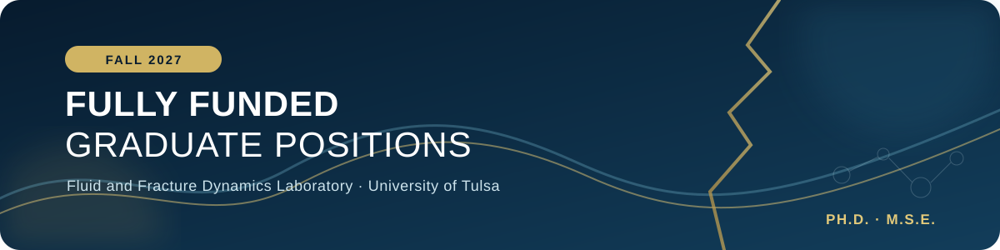

<h1 align="center">Open Graduate Positions in Prof. Du’s Lab</h1>

<h2 align="center">Fall 2027, University of Tulsa</h2>

<strong>Contact</strong>: Dr. Yujing Du

<strong>Email</strong>: <a href="mailto:yujingdu@utulsa.edu">yujingdu@utulsa.edu</a>

<strong>LinkedIn</strong>: <a href="https://www.linkedin.com/in/yujingdu/">https://www.linkedin.com/in/yujingdu/</a>

<picture>
  <source media="(prefers-color-scheme: dark)" srcset="assets/hiring-en-dark.svg">
  <source media="(prefers-color-scheme: light)" srcset="assets/hiring-en-light.svg">
  
</picture>

## Open Positions

The Fluid and Fracture Dynamics Laboratory (FFD Lab), led by Dr. Yujing Du in the Department of Petroleum Engineering at the University of Tulsa, is actively recruiting one fully funded Ph.D. student and one fully funded M.S.E. (Master of Science in Engineering) student starting Fall 2027.

Both positions are fully funded, with a monthly stipend, tuition coverage, and student health insurance in accordance with university policies and assistantship appointments.

## Research directions

Our group investigates fluid-driven fracture mechanics, multiphase flow and transport, phase change, and reactive processes in natural and engineered porous and fractured media (including rocks, soils, biological tissues, and engineered composites). We also study the rheology and interfacial behavior of complex fluids and soft materials, including polymers, gels, foams, and colloidal suspensions, as well as fluid transport in materials designed for extreme environments. Applications include hydrocarbon recovery, geothermal energy, carbon storage, environmental remediation, critical mineral recovery, and advanced materials.

## The University

The University of Tulsa ([https://utulsa.edu/](https://utulsa.edu/)) is a nationally recognized private university located in Tulsa, Oklahoma, historically known as the “Oil Capital of the World.” Tulsa combines a vibrant urban life with affordable living, rich cultural heritage, and abundant outdoor recreation along the Arkansas River.

The Petroleum Engineering program at TU is internationally renowned, with research spanning traditional oil and gas recovery to emerging renewable energy technologies. Strong industry partnerships and a global alumni network provide excellent career opportunities for graduates.

## The Lab

Dr. Yujing Du earned a B.S. in Thermal Engineering from Tsinghua University (2014), an M.S. (2016) and Ph.D. (2021) in Petroleum and Geosystems Engineering from the University of Texas at Austin and completed a postdoctoral fellowship in Applied Physics at Harvard University with Professor David Weitz. Dr. Du joined the University of Tulsa as an Assistant Professor in January 2025.

The Fluid and Fracture Dynamics Laboratory (FFD Lab) explores the fundamental physics of fluid-driven fracture, multiphase flow, particle transport, and reactive processes in natural and engineered porous and fractured media, with particular emphasis on coupled fracture–flow dynamics, complex-fluid rheology, interfacial phenomena, and phase behavior under confinement. Through controlled experiments, visualization, and quantitative analysis across scales, the group aims to advance fundamental understanding of these processes and support applications in hydrocarbon recovery, geothermal energy, carbon storage, and critical mineral recovery.
